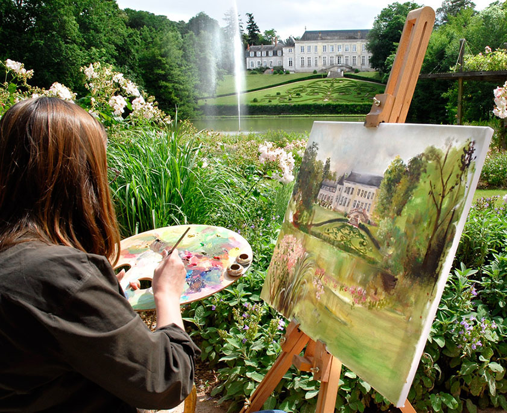
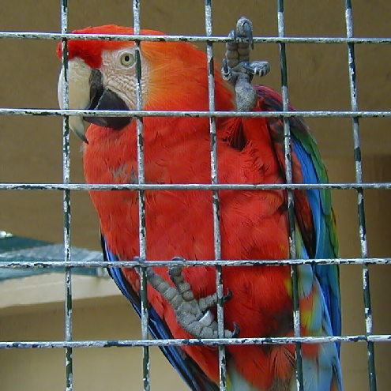
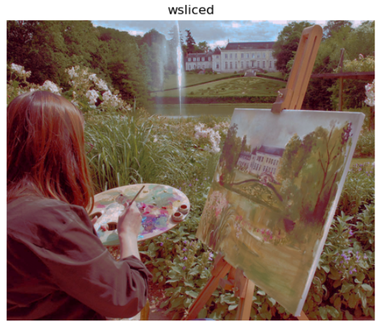

# 🎨 Transfert de Couleur par Transport Optimal

## 🎯 Résultat (avant / après)

L'algorithme capture la palette de couleurs de l'image « Cible » et l'applique à la géométrie de l'image « Source ».

| Image Source | Image Cible (palette) | Résultat (transfert) |
| :---: | :---: | :---: |
|  |  |  |

*Source des images : jeu de données du cours.*

---

## 📝 Contexte et objectif

Projet d'apprentissage réalisé pour explorer le traitement d'images en implémentant une méthode de transfert de couleur.
Il s'agit d'extraire la distribution des couleurs d'une image de référence et de l'appliquer au contenu d'une autre image, en conservant les détails de cette dernière. Le travail s'appuie sur le cadre mathématique du **transport optimal**.

**Méthode implémentée :** Développée dans le notebook.

### 🛠️ Outils et technologies
- **Langage et environnement :** Python, Jupyter Notebook
- **Domaines :** traitement d'images (vision par ordinateur), mathématiques appliquées
- **Bibliothèques :** `NumPy` (calcul matriciel), `OpenCV` (traitement d'images), `Matplotlib` (visualisations 2D et 3D)

### 📂 Contenu du dépôt
- 📓 `transfert_couleur_transport_optimal.ipynb` : notebook principal (implémentation, extraction des canaux RGB, visualisations).
- 🖼️ `Images/` : images utilisées pour l'illustration.

> 💡 Le notebook contient ses sorties pré-calculées : le fonctionnement de l'algorithme est visible sans exécuter le code.

---

## ⚠️ Limites et pistes d'amélioration

**Limites**
- Résultat illustré sur une seule paire d'images.
- Aucune mesure quantitative de la qualité du transfert .

**Pistes d'amélioration**
- Comparer avec une méthode simple (alignement de la moyenne et de l'écart-type par canal) pour montrer ce que le transport optimal apporte.
- Tester sur plusieurs paires d'images et mesurer le temps de calcul.

---

🇬🇧 <b>English version</b>

# 🎨 Color Transfer via Optimal Transport

## 🎯 Result (before / after)

The algorithm captures the color palette of the "Target" image and applies it to the geometry of the "Source" image.

| Source image | Target image (palette) | Result (transfer) |
| :---: | :---: | :---: |
|  |  |  |

*Image source: From coursework.*

## 📝 Context and goal

Learning project to explore image processing by implementing a color transfer method: extract the color distribution of a reference image and apply it to the content of another one while preserving its details. The work relies on the mathematical framework of **optimal transport**.

**Implemented method:** describe in the notebook.

### 🛠️ Tools
- **Language and environment:** Python, Jupyter Notebook
- **Domains:** image processing (computer vision), applied mathematics
- **Libraries:** `NumPy`, `OpenCV`, `Matplotlib`

### 📂 Repository content
- 📓 `transfert_couleur_transport_optimal.ipynb`: main notebook (implementation, RGB channel extraction, visualizations).
- 🖼️ `Images/`: images used for illustration.

> 💡 The notebook includes pre-computed outputs, so you can see how the algorithm works without running the code.

## ⚠️ Limitations and improvements

**Limitations**
- Result illustrated on a single image pair.
- No quantitative measure of transfer quality .

**Possible improvements**
- Compare with a simple method (per-channel mean and standard deviation matching) to show what optimal transport brings.
- Test on several image pairs and measure computation time.

